# Biography

August 31, 1931 to May 18, 2018 (age 86).

(1951–53) U. S. Air Force. Married; five children, nine grandchildren.

## Teaching

**1950s.** Ohio State University, B.A., M.A. and Ph.D. in Fine Arts: Painting and Perception. Awarded Prix de Rome for collaborative architectural design.

**Professor**, State University of New York at Oswego. Pioneered multi-image teaching techniques for large survey classes in art history (400+ students). Course was found to teach more, cost less and was voted "most popular on campus."

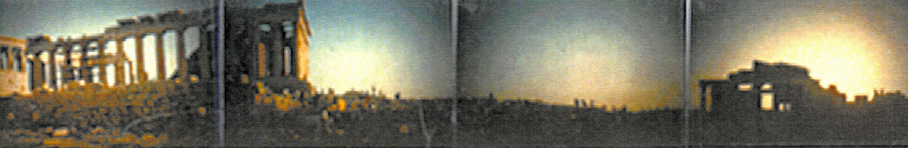

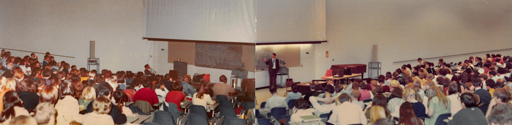

**Professor**, Ohio State University and Ohio colleges. Produced and taught fifteen-part lecture series (multi-image production with soundtrack), for large college classes, "Prehistory to the Present."

Traveled extensively through North America, Western Europe and Greece to research and photograph for the art history lectures. Received grants from Samuel H. Kress Foundation and the United States Department of Health, Education, and Welfare to package the automated lecture series for developing colleges in the South.

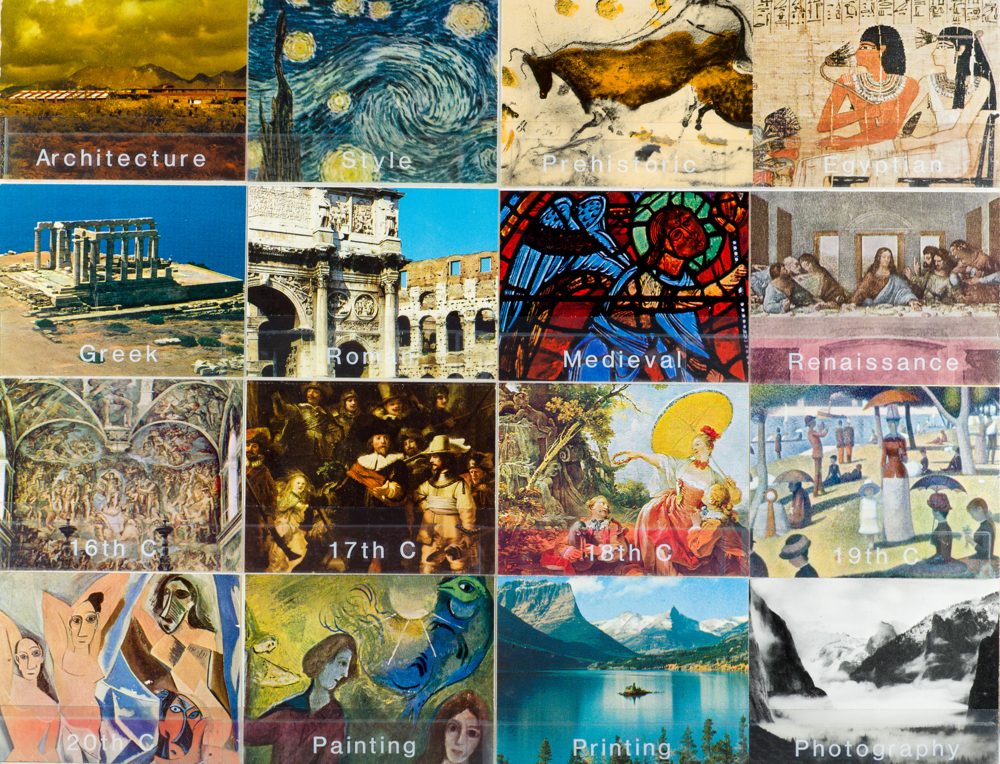

## Painting

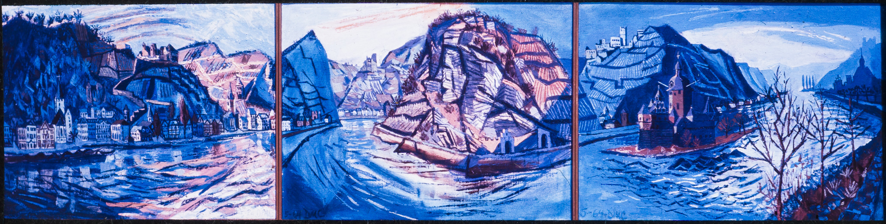

*The Rhine,* 1964, oil on canvas, 109 x 27"

**1965.** Solo exhibition at New Masters Gallery, New York. Review by John Gruen, art critic for the New York Herald Tribune.

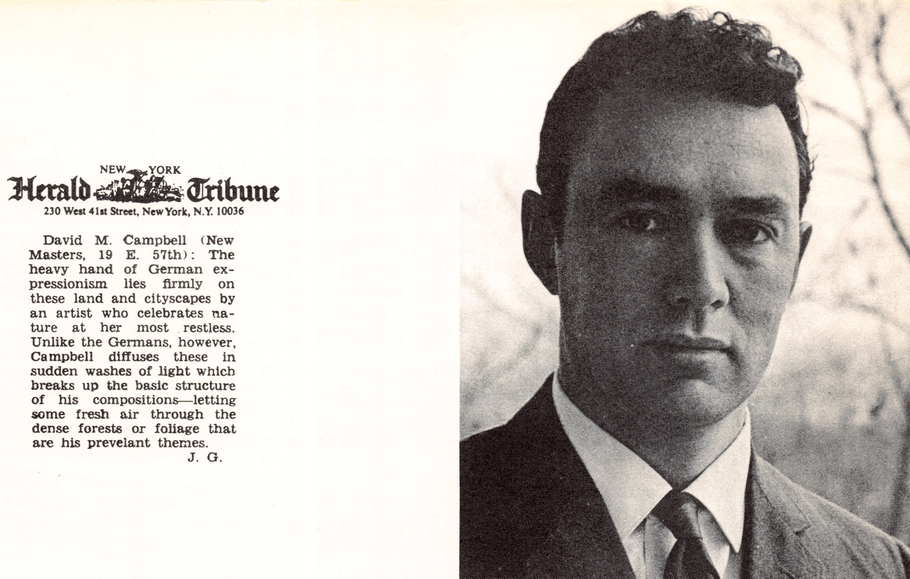

Awarded regional exhibition prizes for paintings, prints, and portraits. Paintings purchased by Munson-Williams-Proctor Arts Institute, Utica, NY; Columbus Museum of Fine Arts, Columbus, Ohio, and private collectors.

## Media Production

**David Campbell Productions.** Founded and directed multi-media company that produced 45 multi-image presentations for a wide variety of clients in business, industry, government and academia.

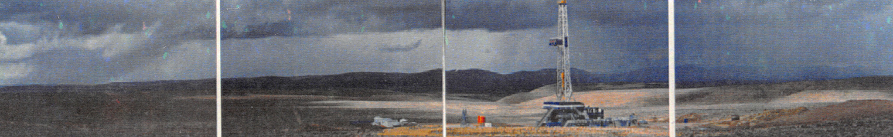

**Apache Corporation** – told dramatic story of oil/gas exploration to potential investors, helping to raise $70 million in 10 days on a 20 city tour. (1982, 30 minutes, 12 projectors)

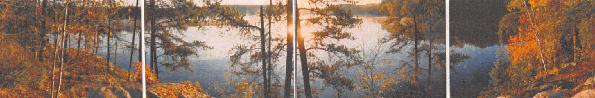

**Minnesota Wellspring** – University of Minnesota and State of Minnesota. A non-profit collaboration between education, business, government and labor. Toured state-wide with over 125 showings. (1980, 60 minutes, 16 projectors)

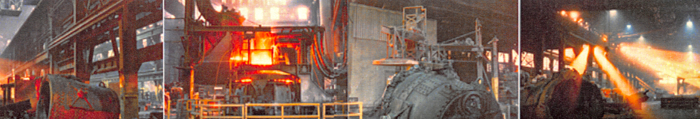

**America Growing** – White House Conference on Balanced National Growth and Economic Development to inform 3000 delegates on critical issues, narrated by Henry Fonda. Photographed in 50 states, and toured nationally for more than 5 years. (1976, 60 minutes, 12 projectors)

## Interactive Multi-media (CD-ROM)

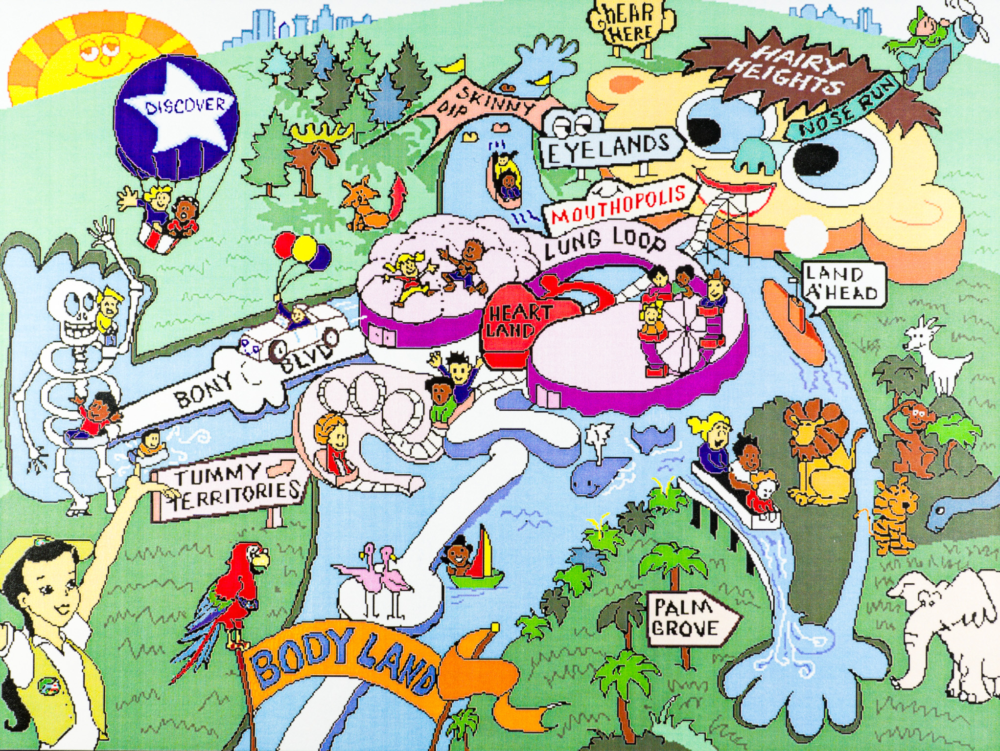

Designer, Art Director: *What Is a Bellybutton?* and *Bodyland* for Interactive Ventures Inc. and Time/Life Children's Books.

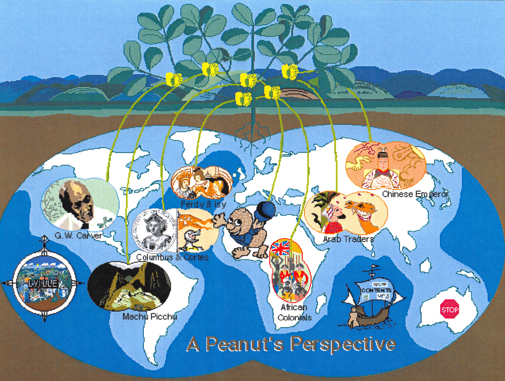

Producer, Art Director and Artist for *Peanut Butter: How It's Made* for Lerner Publications Inc.

## David Campbell & Associates Inc.

Founded and directed a learning courseware company to teach upper management new skills for dealing with complex issues and information.

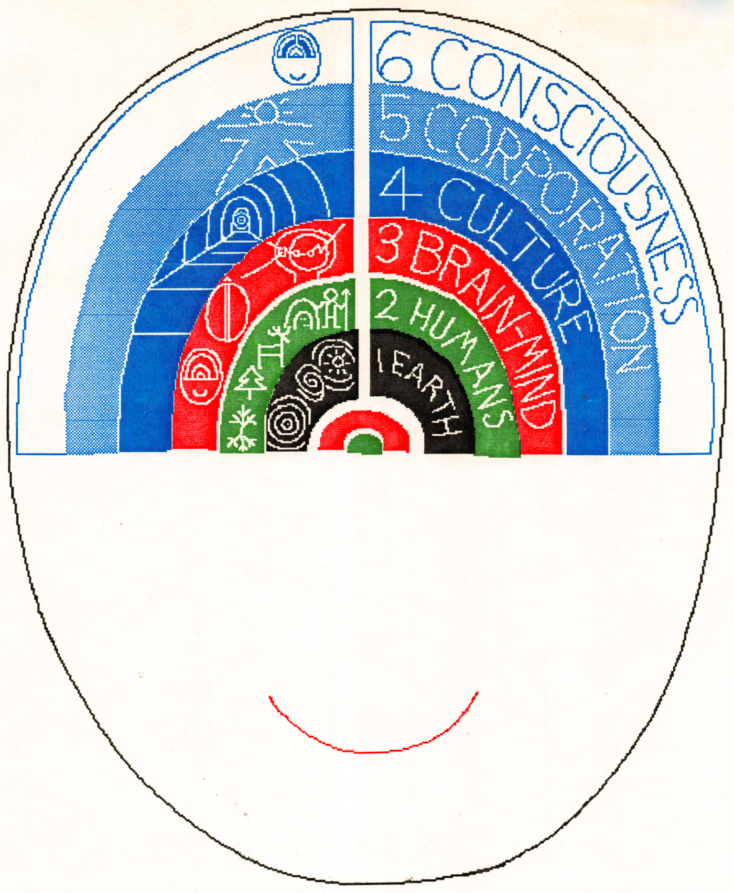

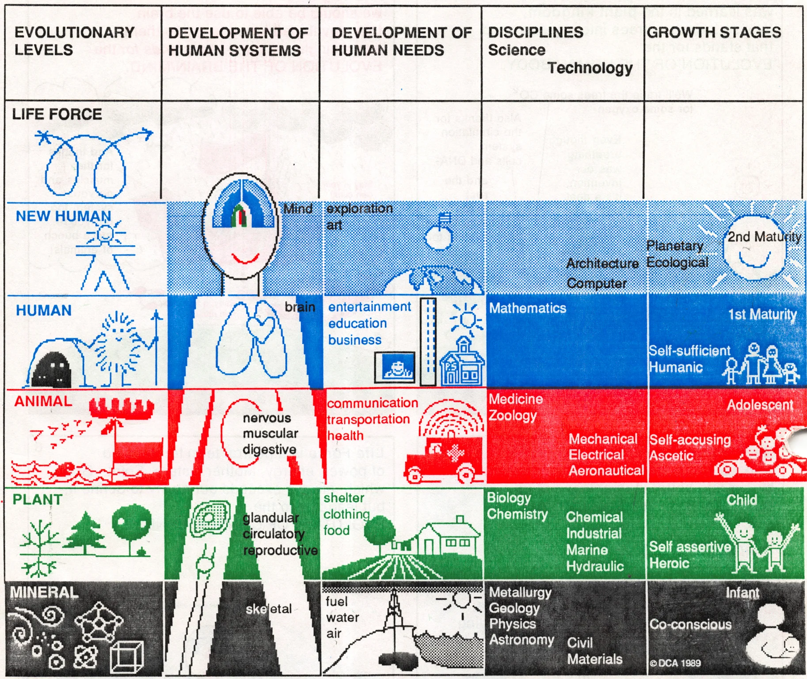

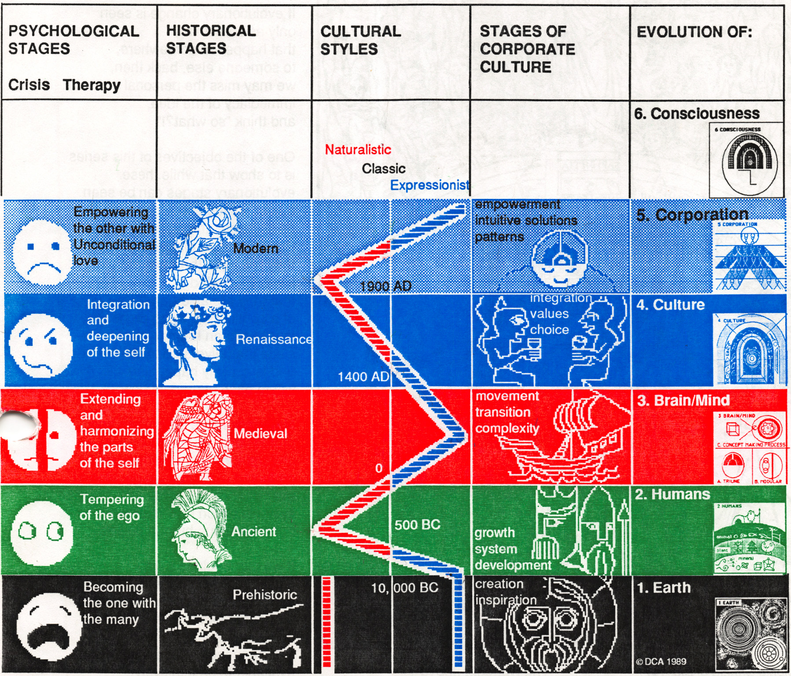

## 1990s to 2018

Painting, printing, and sculpture production.
